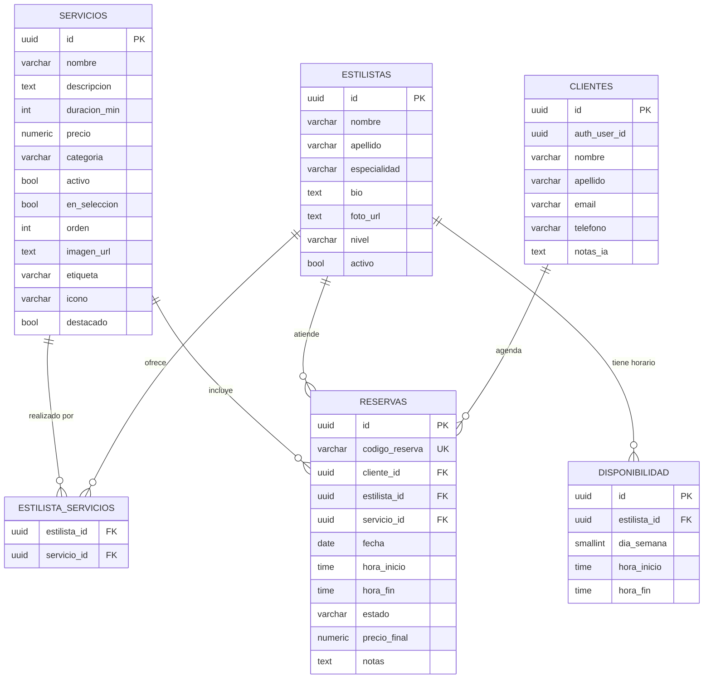

# Arquitectura de Base de Datos — Peluquería Carolina

## Tecnología
**Supabase (PostgreSQL)** — Base de datos relacional gestionada con RLS integrado y cliente REST/JS.

---

## Diagrama Entidad-Relación



---

## Tablas

| Tabla               | Descripción |
|---------------------|-------------|
| `servicios`         | Catálogo de servicios con duración y precio |
| `estilistas`        | Perfiles y niveles de los profesionales |
| `estilista_servicios` | Relación N:M entre estilistas y servicios |
| `disponibilidad`    | Bloques horarios semanales por estilista |
| `clientes`          | Clientes registrados (se vincula con `auth.users` en Fase 8) |
| `reservas`          | Historial y estado de todas las citas |

---

## Estados de una Reserva

```
pendiente → confirmada → completada
                      ↘ cancelada
                      ↘ no_asistio
```

| Estado       | Descripción |
|--------------|-------------|
| `pendiente`  | Creada, en espera de confirmación del salón |
| `confirmada` | Aprobada, aparece en el calendario del estilista |
| `cancelada`  | Cancelada por el cliente o el salón |
| `completada` | El servicio fue realizado |
| `no_asistio` | El cliente no se presentó |

---

## Niveles de Estilista

| Nivel     | Descripción |
|-----------|-------------|
| `artisan` | Profesional con experiencia media |
| `senior`  | Especialista avanzado |
| `master`  | Maestro del sector, mayor tarifa |

---

## Seguridad (Row Level Security)

| Tabla               | Lectura       | Escritura |
|---------------------|---------------|-----------|
| `servicios`         | Pública (activos) | Admin solo |
| `estilistas`        | Pública (activos) | Admin solo |
| `disponibilidad`    | Pública       | Admin solo |
| `clientes`          | Solo el propio usuario | Solo el propio usuario |
| `reservas`          | Solo las del usuario | Solo el propio usuario |

> **Nota:** Las políticas RLS de `clientes` y `reservas` se activan completamente en **Fase 8** cuando se integra Supabase Auth.
